<p align="center">
  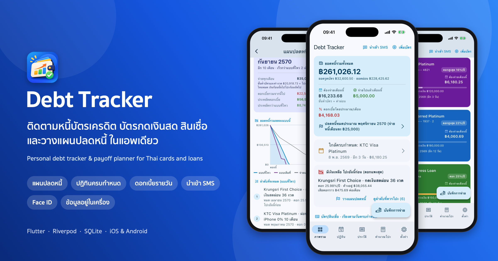
</p>

<p align="center">
  
  
  
  
  
</p>

# Debt Tracker

แอพมือถือสำหรับคนที่มีหนี้หลายก้อน ทั้งบัตรเครดิต บัตรกดเงินสด และสินเชื่อส่วนบุคคล
บอกได้ว่าเดือนนี้ต้องจ่ายเท่าไร จ่ายวันไหน ควรโปะก้อนไหนก่อน และถ้าจ่ายไหวเดือนละเท่านี้ หนี้จะหมดเมื่อไร
ข้อมูลทั้งหมดอยู่ในเครื่อง ไม่มีเซิร์ฟเวอร์ ไม่ต้องสมัครบัญชี

> **English:** a personal finance app for people juggling several debts (credit cards, cash cards, personal loans).
> It shows what is due and when, which debt to pay off first, and when you will be debt-free on a given monthly budget.
> Built with Flutter for iOS and Android; everything stays on the device. The UI is in Thai, with Buddhist-era dates.

## ภาพหน้าจอ

<table>
  <tr>
    <td align="center" width="25%">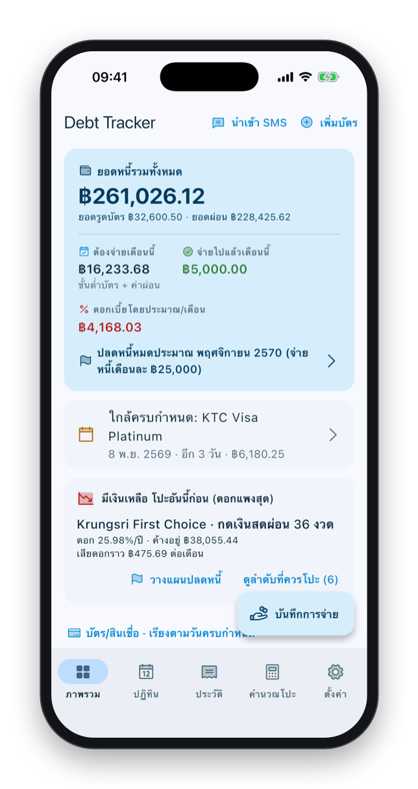<br><b>ภาพรวม</b><br><sub>หนี้รวม ยอดต้องจ่ายเดือนนี้ และก้อนที่ควรโปะก่อน</sub></td>
    <td align="center" width="25%">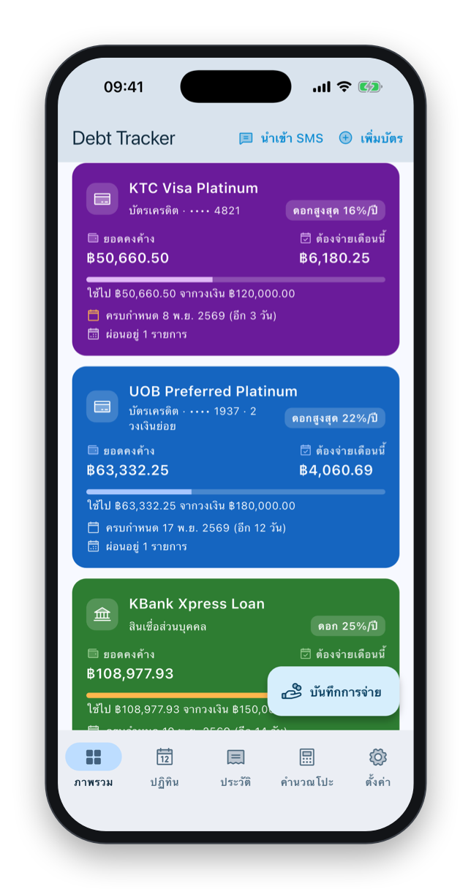<br><b>บัตรและสินเชื่อ</b><br><sub>เรียงตามวันครบกำหนด สีบัตรเลือกได้ต่อใบ</sub></td>
    <td align="center" width="25%">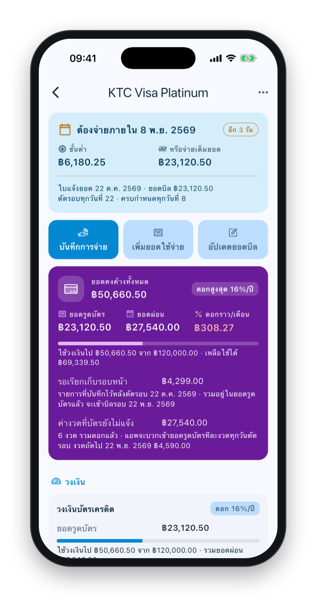<br><b>รายละเอียดบัตร</b><br><sub>ขั้นต่ำ เต็มยอด ค่างวดที่บัตรยังไม่แจ้ง</sub></td>
    <td align="center" width="25%">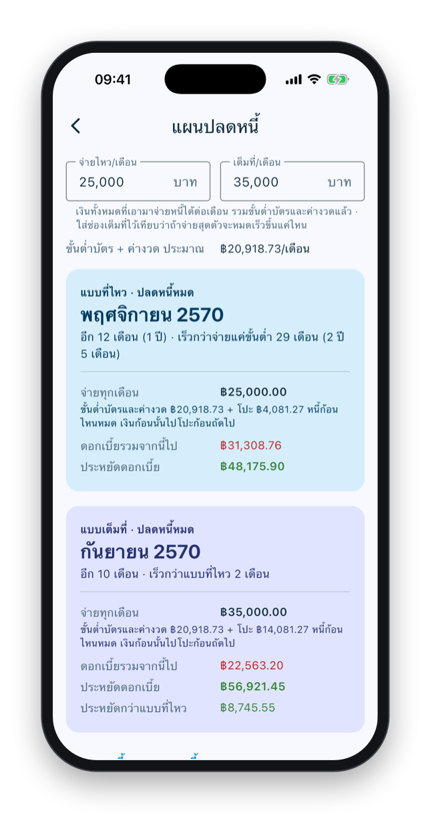<br><b>แผนปลดหนี้</b><br><sub>จ่ายไหวเท่านี้ หนี้หมดเดือนไหน ประหยัดดอกเท่าไร</sub></td>
  </tr>
  <tr>
    <td align="center">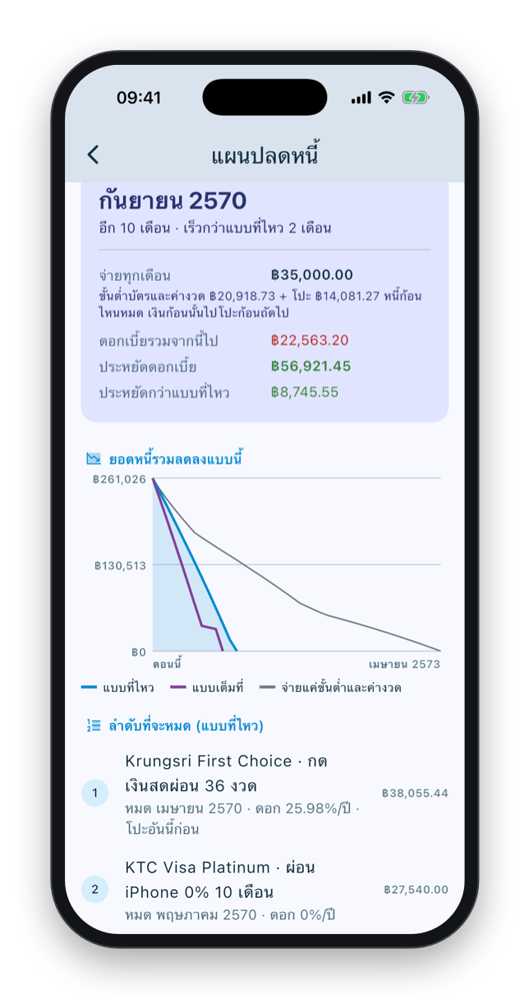<br><b>กราฟยอดหนี้</b><br><sub>เทียบแบบที่ไหว แบบเต็มที่ และจ่ายแค่ขั้นต่ำ</sub></td>
    <td align="center">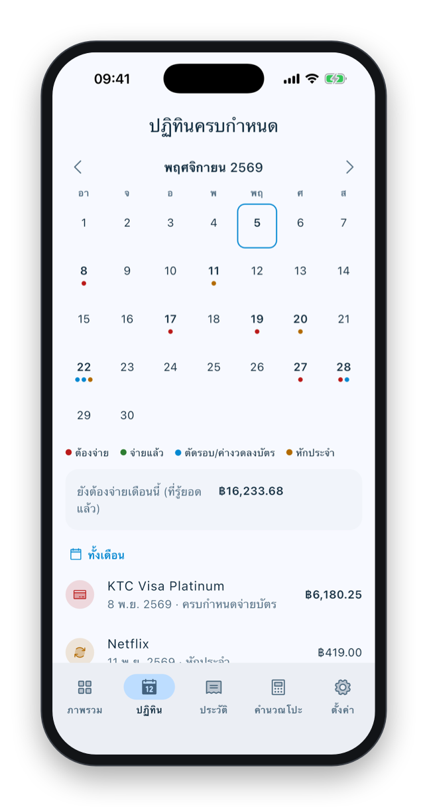<br><b>ปฏิทินครบกำหนด</b><br><sub>วันจ่ายบิล ค่างวด วันตัดรอบ รายการหักประจำ</sub></td>
    <td align="center">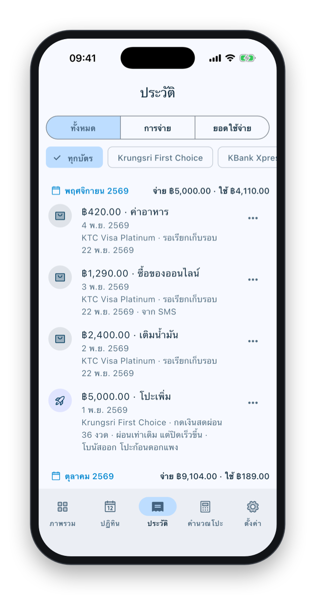<br><b>ประวัติ</b><br><sub>การจ่ายและยอดใช้จ่าย กรองตามบัตรได้</sub></td>
    <td align="center">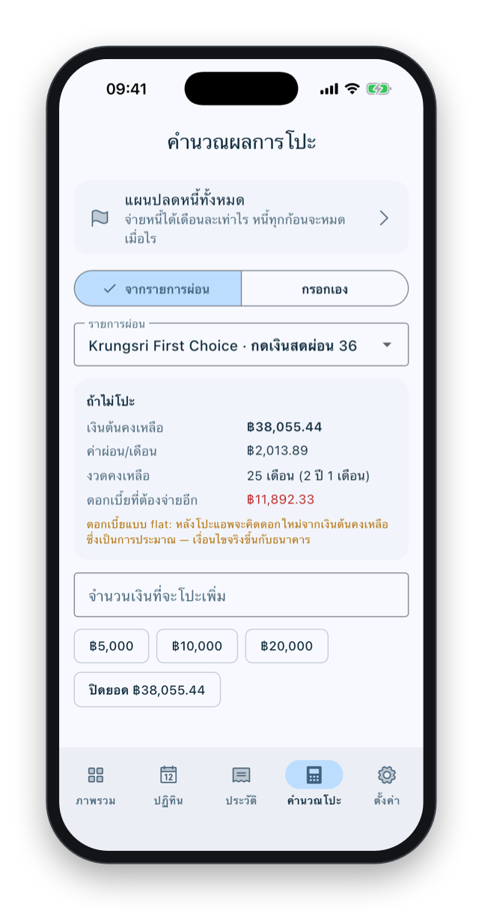<br><b>คำนวณโปะ</b><br><sub>ลดค่างวด หรือผ่อนเท่าเดิมแต่ปิดเร็วขึ้น</sub></td>
  </tr>
  <tr>
    <td align="center">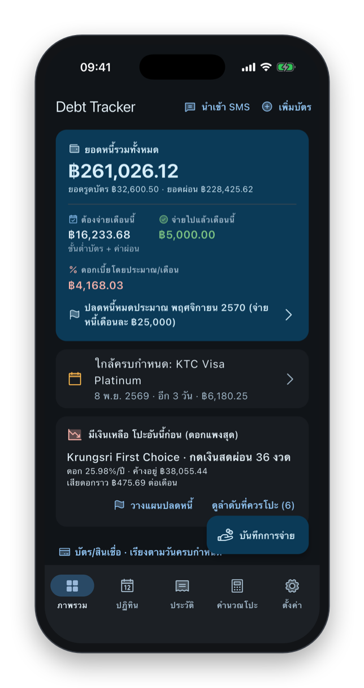<br><b>โหมดมืด</b><br><sub>ธีมสว่าง มืด น้ำเงิน หรือตามเครื่อง</sub></td>
    <td align="center">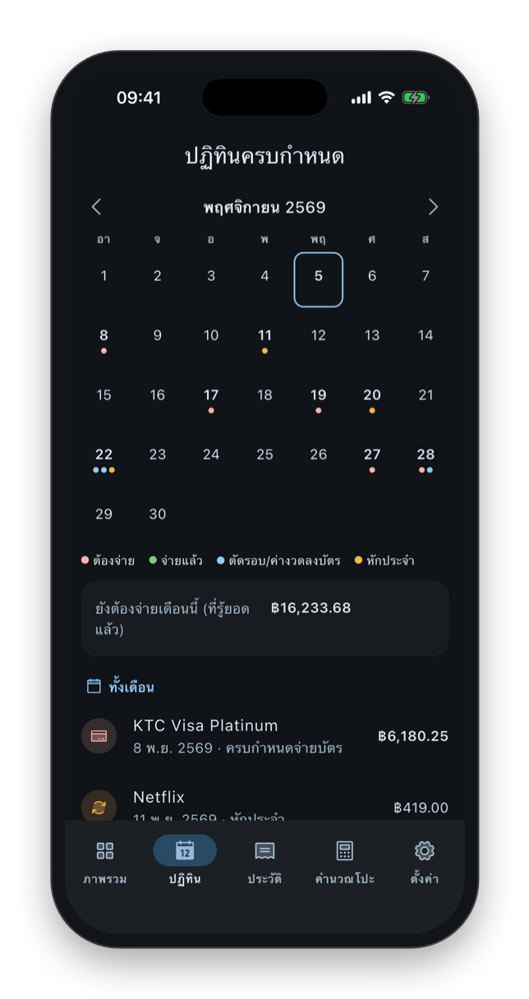<br><b>โหมดมืด</b><br><sub>ปฏิทินครบกำหนด</sub></td>
    <td colspan="2"></td>
  </tr>
</table>

<sub>ภาพหน้าจอใช้ข้อมูลสมมติทั้งหมด สร้างใหม่ได้ด้วยสคริปต์ใน [`tool/screenshots/`](tool/screenshots/)</sub>

## ฟีเจอร์เด่น

- **แผนปลดหนี้**: ใส่เงินที่จ่ายหนี้ได้ต่อเดือน (รวมขั้นต่ำบัตรและค่างวดแล้ว) แอพจำลองหนี้ทุกก้อนเดือนต่อเดือน เงินที่เหลือโปะก้อนดอกแพงสุดก่อน (avalanche) แล้วบอกเดือนที่หนี้หมด ดอกเบี้ยที่ประหยัดได้ และลำดับที่แต่ละก้อนจะหมด
- **ต้องจ่ายเท่าไร วันไหน**: ปฏิทินรวมวันครบกำหนดบัตร ค่างวด วันตัดรอบ และรายการหักประจำ พร้อมแจ้งเตือนก่อนถึงวัน
- **คิดดอกแบบธนาคาร**: ดอกรายวันตามจำนวนวันจริง ดอกโปรโมชั่นแบบขั้นบันได flat rate พร้อมอัตราดอกที่แท้จริง lock-in และยอดปิดรวมค่าปรับ
- **บัตรเดียวหลายวงเงิน**: วงเงินบัตรกับวงเงินสินเชื่อในบัตรใบเดียวคิดดอกต่างกันได้ ค่างวดที่ผ่อนบนบัตรลงยอดให้ทุกวันตัดรอบ
- **คำนวณโปะ**: เทียบ "ลดค่างวด" กับ "ผ่อนเท่าเดิมแต่ปิดเร็วขึ้น" ก่อนตัดสินใจ
- **นำเข้าจาก SMS ธนาคาร**: Android อ่าน SMS ให้ ส่วน iOS วางข้อความที่คัดลอกมา ทุกรายการต้องยืนยันก่อนบันทึก
- **เป็นส่วนตัว**: ข้อมูลอยู่ใน SQLite ในเครื่อง ล็อกแอพด้วย Face ID และสำรองไฟล์แบบเข้ารหัส AES-256-GCM ได้
- **ใช้ง่าย**: ไอคอน Phosphor สองโทน วันที่แบบ พ.ศ. แตะนอกช่องกรอกแล้วคีย์บอร์ดปิดเอง และมี home screen widget

## เทคโนโลยีที่ใช้

| ส่วน | ที่ใช้ |
|---|---|
| UI | Flutter 3.41, Material 3, [Phosphor Icons](https://phosphoricons.com) |
| State | Riverpod 2 |
| ฐานข้อมูล | sqflite (SQLite) พร้อม migration ตามเวอร์ชัน |
| การคำนวณ | Dart ล้วนใน `lib/domain/finance/` (ผ่อนชำระ, ดอกรายวัน, แผนปลดหนี้, ปฏิทิน) แยกจาก UI |
| เนทีฟ | iOS WidgetKit (Swift), Android SMS receiver และ widget (Kotlin) |
| ระบบ | flutter_local_notifications, local_auth (Face ID / สแกนนิ้ว), home_widget |
| ความปลอดภัย | `cryptography`: AES-256-GCM, PBKDF2-HMAC-SHA256 |
| ทดสอบ | unit test สูตรคำนวณ, SMS parser, ledger และ smoke test ทุกหน้าจอ |

## เริ่มใช้งาน

```bash
flutter pub get
flutter run            # เลือก iOS simulator / Android emulator / เครื่องจริง
flutter test           # unit test สูตรคำนวณ, SMS parser, ฐานข้อมูล, backup + smoke test ทุกหน้าจอ
```

ต้องการ iOS 15+ / Android 7.0 (API 24)+

<details>
<summary><b>ฟีเจอร์ทั้งหมดและตำแหน่งในโค้ด</b></summary>

| ฟีเจอร์ | ที่อยู่ในโค้ด |
|---|---|
| แดชบอร์ด: หนี้รวม, ต้องจ่ายเดือนนี้ (ขั้นต่ำ + ค่าผ่อน), แจ้งเตือนใกล้/เลยกำหนด, ควรโปะอันไหนก่อน (ดอกสูง→ต่ำ, avalanche), บัตรเรียงตามวันครบกำหนด + ไฮไลต์ดอกแพงสุด | `lib/ui/screens/dashboard_screen.dart` |
| รายละเอียดบัตร: กล่อง "ต้องจ่ายภายใน" (ขั้นต่ำ/เต็มยอด/ค่างวด), ปุ่มลัด จ่าย/ใช้จ่าย/อัปเดตยอดบิล, วงเงินย่อย, รายการผ่อน (ข้อมูลหลัก + รายละเอียดแบบย่อ/ขยาย: lock-in, ยอดปิดรวมค่าปรับ), ประวัติจ่าย | `account_detail_screen.dart`, `schedule_screen.dart` |
| ปฏิทินครบกำหนด (แท็บ "ปฏิทิน"): วันจ่ายบิลบัตร (พร้อมยอดเมื่อบิลออกแล้ว), ค่างวดที่จ่ายแยก, วันตัดรอบและค่างวดที่ลงบัตร, รายการหักประจำ; จุดสีบอกต้องจ่าย/จ่ายแล้ว แตะวันเพื่อดูเฉพาะวันนั้น | `lib/domain/finance/due_calendar.dart`, `calendar_screen.dart` |
| ประวัติ: การจ่ายและยอดใช้จ่ายรวมกัน กรองตามประเภท/บัตร แตะเพื่อเปิดบัตร | `history_screen.dart` |
| บันทึกการจ่ายแบบเร็ว พร้อมพรีวิวผลกระทบ | `payment_form_screen.dart` |
| บันทึกยอดใช้จ่าย (ซื้อของ) พร้อมรายละเอียด บวกเข้ายอดคงค้างของวงเงินย่อย ลบแล้วหักคืน; แสดงยอดที่รอเรียกเก็บรอบหน้า (ใช้หลังวันตัดรอบ) | `account_detail_screen.dart`, `lib/domain/models/spending.dart` |
| ยอดย้อนหลังไม่นับซ้ำ: จำเวลาที่แก้ยอดคงค้างตามแอพธนาคารล่าสุด ยอดใช้จ่าย/การจ่ายที่ลงวันที่ก่อนวันนั้นเก็บเข้าประวัติอย่างเดียว รายการลงวันที่ย้อนหลังมีสวิตช์ให้เลือกเสมอ; แก้ไขยอดใช้จ่ายได้ (แตะรายการ หรือเมนู ⋯) | `lib/data/services/ledger_service.dart`, `lib/domain/models/credit_line.dart` |
| รายการหักประจำ (Netflix ฯลฯ ทุกเดือน/ทุกปี): บันทึกเป็นยอดใช้จ่ายให้เองเมื่อถึงวันหัก ตามเก็บรอบที่พลาดตอนเปิดแอพ, หยุดชั่วคราว/แก้ไข/ลบได้, ไม่บันทึกซ้ำกับ SMS ธนาคาร | `account_detail_screen.dart`, `lib/domain/models/recurring_charge.dart`, `ledger_service.dart` |
| รายการผ่อนบนบัตร: ถาม "บัตรแจ้งถึงงวดที่" แทนวันครบกำหนด, บวกค่างวดเข้ายอดรูดบัตร/กดเงินสดทุกวันตัดรอบ (เก็บเป็นยอดใช้จ่าย ตามเก็บรอบที่พลาด), แสดงค่างวดที่บัตรยังไม่แจ้งรวมดอก | `plan_form_screen.dart`, `ledger_service.dart`, `account_detail_screen.dart` |
| รายการผ่อนที่จ่ายแยก: ไม่รู้เงินต้นก็คำนวณจากค่าผ่อน/ดอก/จำนวนงวดได้, ฟอร์มบอกว่าจะติ๊กถึงงวดไหนและเตือนเมื่อเกินหรือขาดจากงวดที่ครบกำหนด (รวมค่างวดที่บันทึกในแอพแล้ว), แก้ไขรายการจ่ายได้ (แตะรายการ หรือเมนู ⋯) | `plan_form_screen.dart`, `payment_form_screen.dart`, `ledger_service.dart` |
| แผนปลดหนี้: ใส่เงินโปะเพิ่มต่อเดือน แอพจำลองทุกก้อนรายเดือน (ขั้นต่ำบัตรตามสัดส่วนในบิล, ค่างวด, เงินโปะลงก้อนดอกแพงสุดที่โปะได้ หนี้ก้อนไหนหมดเงินไปก้อนถัดไป) บอกวันปลดหนี้ ดอกที่ประหยัด ลำดับที่จะหมด และกราฟเทียบกับจ่ายแค่ขั้นต่ำ; แดชบอร์ดบอกวันปลดหนี้ | `lib/domain/finance/payoff_plan.dart`, `payoff_plan_screen.dart`, `lib/ui/widgets/debt_chart.dart` |
| ดอกเบี้ยโปรโมชั่นแบบขั้นบันได (เช่น งวด 1–3 21.99% แล้วงวด 4–6 24%): แต่ละงวดคิดดอกตามช่วงของตัวเอง ค่าผ่อนที่ธนาคารกำหนดคงเดิม (ถ้าไม่ได้กำหนด แอพคำนวณค่าผ่อนใหม่ตอนเปลี่ยนดอก) | `lib/domain/models/installment_plan.dart` (`rateSteps`), `installment_engine.dart`, `plan_form_screen.dart` |
| คิดดอกตามจำนวนวันจริงแบบธนาคาร (ยอด × ดอก × วัน / 365 ปัดถึงสตางค์): ใส่วันที่ได้รับเงิน (และวันชำระงวดแรกสำหรับรายการผ่อนบนบัตร) ดอกงวดแรกนับจากวันได้เงิน งวดสุดท้ายรับส่วนต่าง | `installment_plan.dart` (`disbursedOn`, `firstPaymentOn`), `installment_engine.dart`, `plan_form_screen.dart` |
| คำนวณโปะ: ลดค่าผ่อน vs ผ่อนเท่าเดิมปิดเร็วขึ้น | `calculator_screen.dart`, `lib/domain/finance/prepayment.dart` |
| แจ้งเตือนก่อนครบกำหนด / วันตัดรอบ / งวดสินเชื่อ | `lib/platform/notification_service.dart` |
| Export JSON (เข้ารหัส AES-256-GCM ได้) / CSV, กู้คืน | `lib/data/backup/backup_service.dart` |
| ดึงยอดจาก SMS (Android อ่านอัตโนมัติ, iOS วางข้อความ) | `lib/data/sources/sms/`, `android/.../Sms*.kt` |
| Home screen widget | `android/.../DebtWidgetProvider.kt`, `ios/DebtWidget/DebtWidget.swift` |
| ล็อกแอพด้วย Face ID / สแกนนิ้ว (หรือรหัสเครื่อง): ตอนเปิดแอพ และเมื่อกลับมาหลังออกไปเกิน 1 นาที; เปิด/ปิดในหน้าตั้งค่า ต้องยืนยันตัวตนก่อน | `lib/ui/widgets/app_lock_gate.dart`, `lib/platform/app_lock_service.dart` (Android ใช้ `FlutterFragmentActivity` + AppCompat LaunchTheme) |
| ธีม (ตามระบบ / สว่าง / มืด / น้ำเงิน) เลือกในหน้าตั้งค่า, สีบัตรเลือกได้ต่อใบ (ตัวอักษรบนบัตรปรับให้อ่านง่ายเอง) | `lib/ui/theme.dart`, `lib/ui/widgets/card_colors.dart`, `settings_screen.dart` |
| ไอคอนตามความหมาย (Phosphor สองโทน) ชุดเดียวทั้งแอพ, แตะนอกช่องกรอกแล้วคีย์บอร์ดปิด (ลากเพื่อเลื่อนไม่ปิด) | `lib/ui/widgets/app_icons.dart`, `lib/ui/widgets/keyboard_dismiss.dart` |

</details>

## โครงสร้าง

```
lib/
  core/                 วันที่ (ปี พ.ศ.), รูปแบบเงิน
  domain/
    models/             Account, CreditLine (วงเงินย่อย), InstallmentPlan, Payment
    finance/            LoanMath, LoanState, InstallmentEngine, PrepaymentComparison, PortfolioSummary
  data/
    db/                 SQLite schema
    repositories/       interface + SQLite implementation (สลับแหล่งเก็บได้โดยไม่แตะ UI)
    services/           LedgerService (ทุกการเขียนผ่านที่นี่), SettingsService
    sources/
      statement_source_parser.dart   interface กลาง StatementSourceParser
      sms/                           SmsParserService (implements StatementSourceParser) + config
      email/                         EmailParserService (โครงไว้สำหรับอนาคต)
      statement_import_service.dart  parse → จับคู่บัตร → ให้ผู้ใช้ยืนยัน → บันทึก
    backup/
  platform/             SMS bridge, notifications, home widget
  ui/                   Riverpod providers + screens
assets/sms_patterns.json  regex ของแต่ละธนาคาร (แก้/เพิ่มได้โดยไม่ต้องแก้โค้ด)
```

## โมเดลข้อมูลและการคำนวณ

- **บัตร 1 ใบมีได้หลายวงเงินย่อย** (`CreditLine`) แต่ละอันมีวงเงิน ยอดคงค้าง ดอกเบี้ย และวิธีคิดดอกของตัวเอง
  เช่น วงเงินบัตรเครดิต 16% กับวงเงินสินเชื่อ 25% ในบัตรเดียวกัน ถ้าวงเงินใช้ร่วมกันให้ใส่ "วงเงินรวม"
- **ยอดคงค้างของวงเงินย่อย = ยอดหมุนเวียน ไม่รวมรายการผ่อน** รายการผ่อนเก็บยอดเงินต้นคงเหลือของตัวเอง
- **สถานะรายการผ่อนไม่ได้ถูกเก็บ แต่คำนวณใหม่ (replay) จากประวัติการจ่ายทุกครั้ง** — ลบ/แก้การจ่ายแล้วตัวเลขถูกเสมอ
- **ลดต้นลดดอก**: ดอก = เงินต้นคงเหลือ × r, ค่างวด `P × r / (1 − (1 + r)^−n)`
- **Flat rate**: ดอกต่อเดือนคงที่จากเงินต้นตั้งต้น แอพแสดงอัตราที่แท้จริง (IRR × 12) เช่น flat 10% 12 เดือน ≈ 17.97%
- **โปะเพิ่ม**: ลดค่าผ่อน (คงจำนวนงวด) หรือ ผ่อนเท่าเดิมปิดเร็วขึ้น
  - flat rate หลังโปะ แอพคิดดอกใหม่จากเงินต้นคงเหลือ (เป็นการประมาณ เงื่อนไขจริงแต่ละธนาคารต่างกัน)
- **รายการผ่อนที่รวมอยู่ในยอดบัตร** (เปิดสวิตช์ "ค่างวดรวมอยู่ในยอดเรียกเก็บ"): ไม่ถูกบวกซ้ำในยอดต้องจ่าย งวดเดินทุกวันตัดรอบของบัตร และค่างวดถูกบวกเข้ายอดหมุนเวียนของวงเงินวันนั้น เหมือนที่ธนาคารลงบัตร (ถ้าแก้ยอดตามแอพธนาคารตั้งแต่วันตัดรอบแล้ว จะไม่บวกซ้ำ)
- **จ่ายไปแล้วกี่งวด**: สำหรับสัญญาที่ผ่อนมาก่อนเริ่มใช้แอพ
- **lock-in / ค่าปรับ**: แสดงวันที่ปิดได้เร็วสุด, ยอดปิดรวมค่าปรับ, และ avalanche จะข้ามรายการที่ยังติด lock-in

ทั้งหมดมี unit test ใน `test/domain/`

## SMS ธนาคาร

**Android**: ขอสิทธิ์ `READ_SMS` + `RECEIVE_SMS` พร้อมคำอธิบายในแอพ
- สแกน SMS 45 วันล่าสุด หรือเปิด "รับ SMS ใหม่อัตโนมัติ" (`SmsReceiver.kt` เก็บเฉพาะ SMS ที่ผู้ส่งเป็นธนาคาร
  หรือมีคำว่า ยอดเรียกเก็บ/ชำระ ฯลฯ ไม่เก็บ OTP และแจ้งเตือนให้ตรวจสอบเมื่อปิดแอพอยู่)
- ทุกรายการต้องผ่านหน้า "ตรวจสอบก่อนบันทึก" แก้ไขได้ทุกช่อง ไม่มีการบันทึกอัตโนมัติ
- พาร์สในเครื่องเท่านั้น ไม่ส่ง SMS ออกจากเครื่อง

**iOS**: ไม่มี API อ่าน SMS → คัดลอก SMS แล้ว "วางจากคลิปบอร์ด" ในหน้านำเข้า (ใช้ parser และหน้าตรวจสอบเดียวกับ Android)
ทำให้เร็วขึ้นด้วย Shortcuts: ระบบอัตโนมัติ → ข้อความ (จากธนาคาร) → คัดลอกไปยังคลิปบอร์ด + เปิดแอพ Debt Tracker

**เพิ่ม/แก้รูปแบบ SMS**
- แก้ `assets/sms_patterns.json` (ชื่อผู้ส่งในไฟล์เป็นตัวอย่าง — ตรวจชื่อผู้ส่งจริงในเครื่องแล้วปรับ)
- หรือในแอพ: ตั้งค่า → รูปแบบ SMS ธนาคาร (เก็บในเครื่อง มีช่องทดสอบ)
- มาโคร: `{AMOUNT}`, `{MONEY}` (ต้องมีคอมมาหรือทศนิยม กันสับสนกับเลขท้ายบัตร), `{DATE}` (รองรับ พ.ศ./ค.ศ., "5 พ.ย. 69"), `{CARD}`
- ตัวอย่าง SMS จริงธนาคารละ 1–2 ข้อความช่วยให้ปรับ regex ได้แม่นขึ้นมาก (เพิ่มเป็น test ใน `test/data/sms_parser_test.dart`)

**อีเมล (อนาคต)**: implement `StatementSourceParser` ใน `lib/data/sources/email/email_parser_service.dart`
แล้วเพิ่มใน `statementParsersProvider` (`lib/ui/providers.dart`) — data model และ UI ไม่ต้องแก้

## Home screen widget

- **Android**: กดค้างหน้าโฮม → Widgets → Debt Tracker
- **iOS**: target `DebtWidgetExtension` อยู่ในโปรเจคแล้ว ใช้ App Group `group.com.krittapat.debtTracker` แชร์ข้อมูล
  ก่อนรันบนเครื่องจริง เปิด `ios/Runner.xcworkspace` → Signing & Capabilities ของทั้ง **Runner** และ **DebtWidgetExtension**
  → ตรวจว่า Team ถูกต้องและ App Groups มี `group.com.krittapat.debtTracker` (Xcode จะลงทะเบียนให้)

## ไอคอนแอพ

- `assets/icon/app_icon.png`: สี่เหลี่ยมเต็มกรอบ 1024px ไม่มีมุมโค้งและไม่มีพื้นโปร่งใส (iOS/Android ตัดมุมเอง)
- Android ใช้ adaptive icon: `assets/icon/adaptive_background.png` ย่อภาพให้อยู่ในวงกลมปลอดภัยของ launcher
- แก้รูปแล้วสร้างไอคอนทุกขนาดใหม่ด้วย `dart run flutter_launcher_icons`
- หน้าจอเปิดแอพ iOS (`ios/Runner/Base.lproj/LaunchScreen.storyboard`) ใช้ `LaunchImage` = ไอคอนมุมโค้ง 120pt บนพื้นตามโหมดเครื่อง และค้างไว้อีก 1 วินาทีใน `lib/main.dart`

## ความเป็นส่วนตัว / สำรองข้อมูล

- ไม่มี server ข้อมูลอยู่ใน SQLite ของแอพ
- ไฟล์สำรองตั้งรหัสผ่านได้: AES-256-GCM, key จาก PBKDF2-HMAC-SHA256 (120,000 รอบ) — ลืมรหัสผ่านจะเปิดไฟล์ไม่ได้
- CSV ไม่เข้ารหัส ใช้สำหรับเปิดใน Excel/Sheets

## หมายเหตุ Play Store

Google อนุมัติ `READ_SMS` เฉพาะแอพ SMS/default handler หรือกรณีพิเศษตาม policy
ถ้าใช้เอง (side-load / internal testing) ไม่มีปัญหา ถ้าจะเผยแพร่ต้องเตรียมคำชี้แจงเหตุผล
หรือสร้าง flavor ที่ตัด permission SMS ออก (ฟีเจอร์วางข้อความยังใช้ได้)
